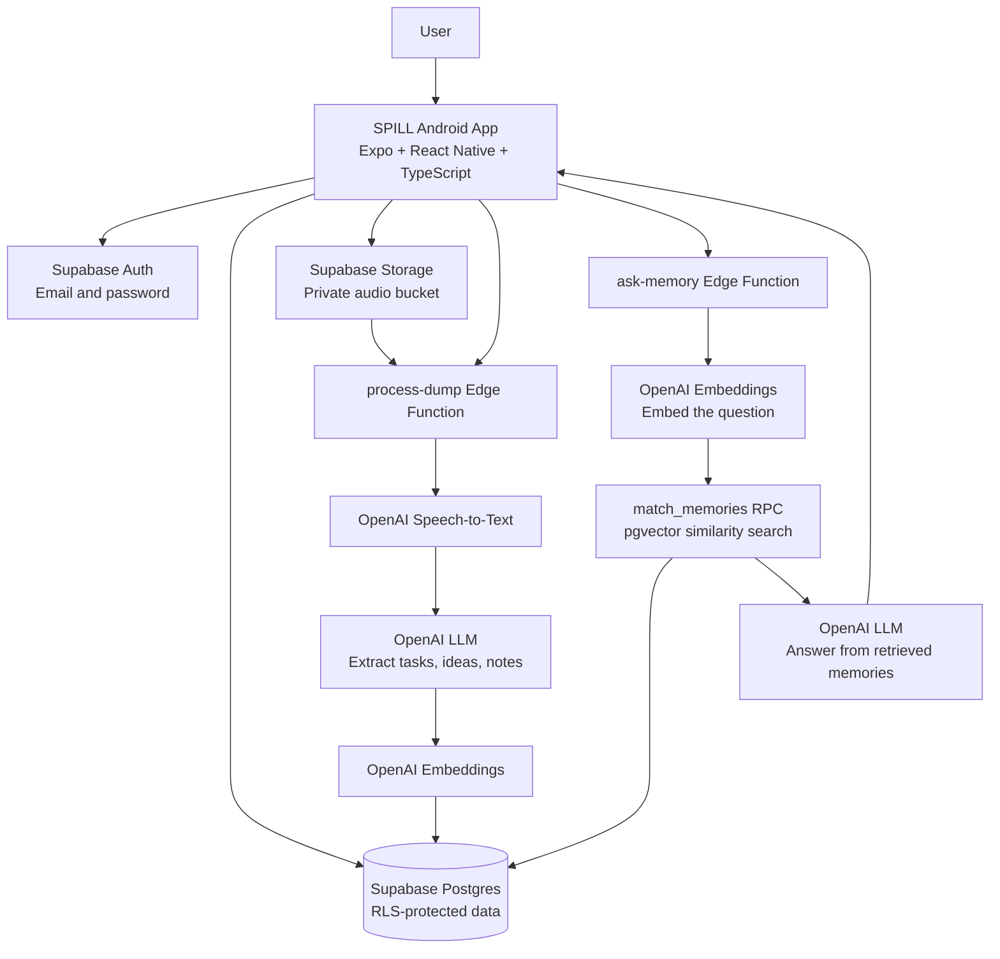

# SPILL — Android voice dumps + persistent AI memory

SPILL turns voice notes and text dumps into searchable tasks, ideas, notes and follow-ups, then lets you ask questions across your saved memories.

## Stack
- Expo / React Native / TypeScript
- Supabase Auth, Postgres, Storage and Row Level Security
- Supabase Edge Functions + OpenAI for transcription, extraction, embeddings and grounded Q&A

## Architecture

SPILL uses a lightweight client–backend architecture. The Android app handles user interaction and uploads; Supabase manages authentication, private data and server-side functions; OpenAI powers transcription, memory extraction, embeddings and question answering.



### Main components

| Component | Responsibility |
|---|---|
| **SPILL mobile app** | Authentication, text dumps, voice recording, memory browsing and asking questions |
| **Supabase Auth** | Creates sessions and identifies the signed-in user |
| **Supabase Storage** | Holds audio files in the private `dumps-audio` bucket |
| **`process-dump` Edge Function** | Validates the session, retrieves uploaded audio, transcribes it, extracts structured memory items and saves embeddings |
| **`ask-memory` Edge Function** | Embeds a question, retrieves semantically similar memories and generates an answer grounded in those results |
| **Postgres + pgvector** | Stores dumps and extracted memories, including vector embeddings for semantic search |
| **Row Level Security (RLS)** | Restricts direct database and storage access to the authenticated user's own records |
| **OpenAI API** | Provides speech transcription, structured extraction, embedding generation and answer generation |

### Data flow

#### 1. Capture and organize a dump
1. The user types a brain dump or records a voice note in the app.
2. For audio, the app uploads the recording to the private Storage bucket under the user's ID.
3. The app calls `process-dump` with the text and/or audio path.
4. The function validates the user's session, transcribes audio when present, and combines it with any entered text.
5. The function stores the original transcript in `dumps`, asks the language model to extract useful items, creates embeddings, and stores those items in `memories`.

#### 2. Ask a question about past memories
1. The user submits a natural-language question.
2. `ask-memory` generates an embedding for the question.
3. The `match_memories` database function uses pgvector similarity to find relevant saved memories for that user.
4. The language model answers using the retrieved memories and returns source memory metadata.

#### 3. Data and security boundaries
- The mobile app uses only the Supabase public/anon key; it must never contain the service-role key or OpenAI API key.
- Server-side secrets are configured in Supabase Edge Function secrets.
- User-owned records are protected by RLS policies.
- Audio is private by default, but the current starter does not yet implement audio-retention automation or complete delete/export workflows.

## Repository structure

```text
spill-android/
├── App.tsx                           # Main React Native app and screens
├── app.json                          # Expo app and Android configuration
├── package.json                      # Dependencies and npm scripts
├── tsconfig.json                     # TypeScript configuration
├── .env.example                      # Public client environment variable template
├── .gitignore                        # Excludes local secrets and build output
├── README.md                          # Setup, architecture and project guide
└── supabase/
    ├── schema.sql                    # Tables, pgvector, RLS, Storage and RPC
    └── functions/
        ├── process-dump/
        │   └── index.ts              # Transcription and memory extraction
        └── ask-memory/
            └── index.ts              # Semantic retrieval and grounded Q&A
```

### Key database entities

- **`dumps`** — original transcript, owner, optional audio path and creation timestamp.
- **`memories`** — extracted task, idea, note, follow-up, person or event; includes content, tags, optional due date and embedding.
- **`memory_links`** — intended relationship layer for connecting related memories as the product evolves. It is part of the broader design goal; confirm its table and linking logic are implemented before relying on it in the current database.

## Setup

### 1. Run the Android app

Install Node.js LTS, Git, and Expo Go on your Android phone.

```bash
git clone https://github.com/AP-24001064/spill-android.git
cd spill-android
npm install
cp .env.example .env
```

Create a Supabase project, then put its project URL and anon/publishable key in `.env`:

```env
EXPO_PUBLIC_SUPABASE_URL=https://YOUR_PROJECT_ID.supabase.co
EXPO_PUBLIC_SUPABASE_ANON_KEY=YOUR_SUPABASE_PUBLISHABLE_OR_ANON_KEY
```

### 2. Configure Supabase

1. Open the Supabase SQL Editor and run `supabase/schema.sql`.
2. The SQL creates a private `dumps-audio` Storage bucket and policies.
3. Enable Email/password authentication in Supabase Auth settings.
4. Do not disable Row Level Security or put a service-role key in the mobile app.

### 3. Configure and deploy the backend

Install the Supabase CLI and link your project:

```bash
npm install -g supabase
supabase login
supabase link --project-ref YOUR_PROJECT_REF
supabase secrets set OPENAI_API_KEY=YOUR_OPENAI_API_KEY
supabase secrets set SUPABASE_URL=https://YOUR_PROJECT_ID.supabase.co
supabase secrets set SUPABASE_ANON_KEY=YOUR_SUPABASE_ANON_KEY
supabase secrets set SUPABASE_SERVICE_ROLE_KEY=YOUR_SERVICE_ROLE_KEY
supabase functions deploy process-dump
supabase functions deploy ask-memory
```

Keep the OpenAI and service-role keys in Supabase secrets only.

### 4. Start the app

```bash
npx expo start
```

Scan the QR code with Expo Go. For a standalone Android build, configure EAS Build later. No paid domain is required.

## What works in this starter
- Email/password registration and sign-in
- Record a voice dump or enter text
- Submit a dump for transcription and extraction
- Store extracted memory items and embeddings
- Ask natural-language questions over retrieved memories

## Important
This is a starter scaffold, not a production-ready app. Configure and test Supabase before use. AI API calls may cost money. Audio is stored in your private bucket unless you add retention/deletion logic. Before public release add deletion/export controls, retries, rate limits, file-size limits, date-editing, and privacy messaging. No paid domain is required.